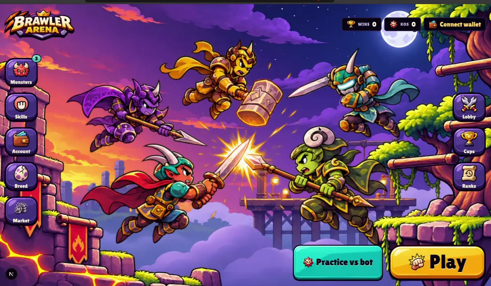
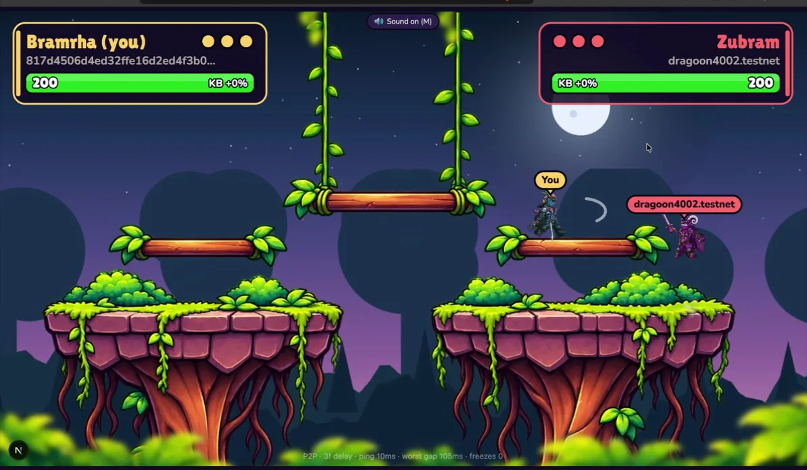
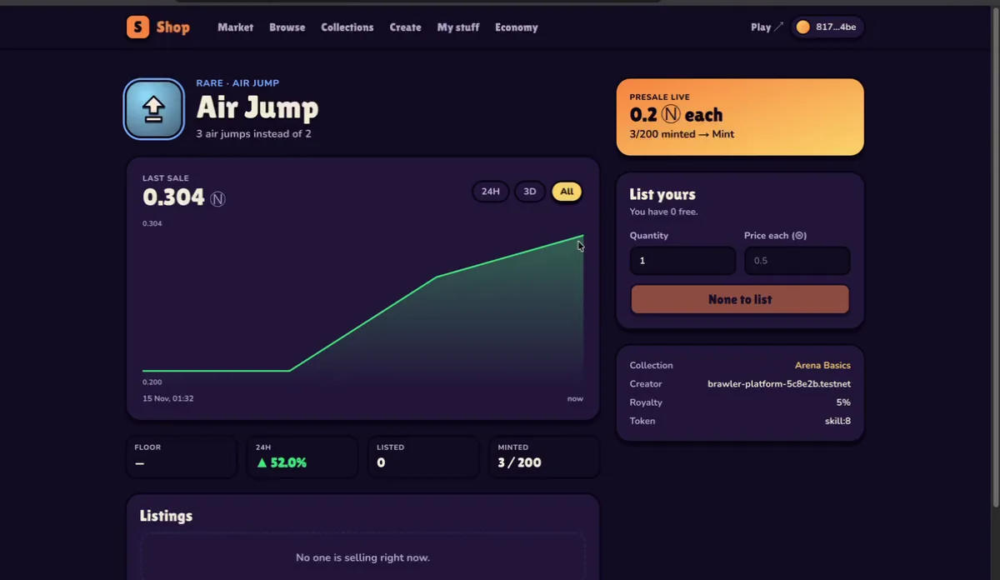
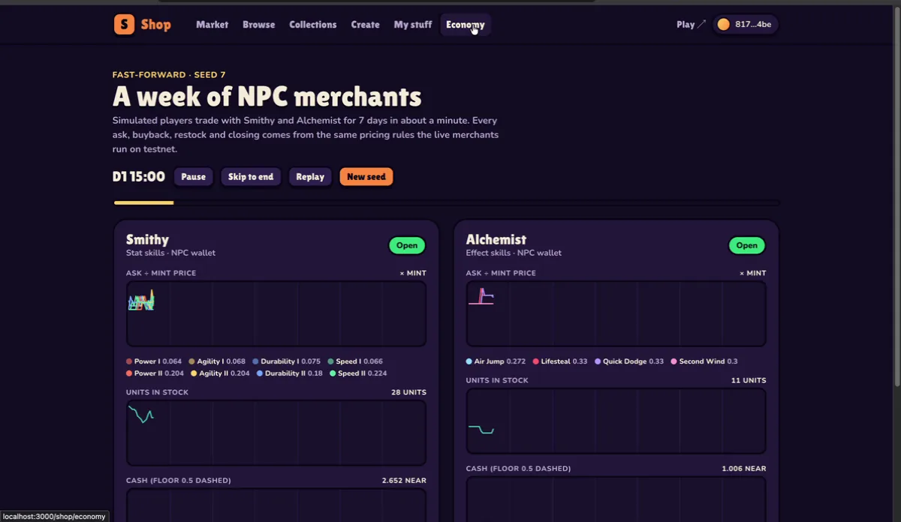
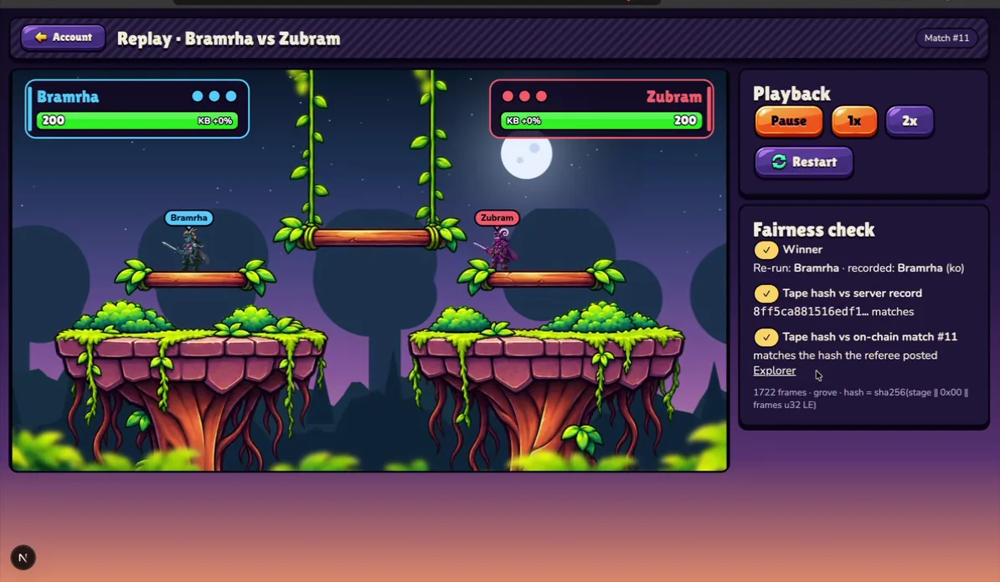

# Brawler Arena



**You fight, you win, and you keep it.** Brawler Arena is a real-time 1v1 platform fighter on NEAR testnet. Every fighter is a NEP-171 NFT whose on-chain DNA sets its stats. Every skill is a NEP-245 token you mint, trade and equip. Every staked match, spectator bet and tournament settles in a contract, and every result can be re-checked in your browser. You sign in with Google, with no seed phrase and no extension. NPC merchants with their own wallets keep the skill market liquid.

| | |
|---|---|
| **Play now (hosted)** | **https://13-54-190-122.sslip.io**: Practice vs bot needs nothing; **Play as guest** gives you a funded account in one click. Google login works on `localhost:3000` only (testnet NEAR Auth limit) |
| Shop (hosted) | https://market.13-54-190-122.sslip.io |
| Run it locally | [Run everything locally](#run-everything-locally): game `localhost:3000`, Shop `localhost:3000/shop`, server `localhost:8787` |
| Demo video | X post: _link added at submission_ |
| Tracks | `games` (Games With Real Economies), `nfts` (NFTs That Do Something) |
| Network | NEAR testnet · License: MIT |

## Screenshots

| | |
|---|---|
|  **Staked 1v1 fight**, settled on-chain |  **NEP-245 skill** `skill:8`: price history, supply cap, royalty |
|  **NPC merchants**: a week of trading in about a minute |  **Fairness check**: winner and tape hash vs the contract |

## The problem

Online games with wagers ask players to trust the operator: that it holds the stakes, reports the real winner and pays out. Game items are database rows the player can't sell, lend or take elsewhere. Getting started on a blockchain game usually means a seed phrase, an extension and a gas prompt on every click.

Brawler Arena moves the money, the result and the items onto NEAR, and keeps the chain out of the player's way:

- **The operator never holds funds.** Stakes and bets sit in the platform contract. The game server can only sign a result. The winner submits it, and the contract checks the signature with `ed25519_verify`.
- **Results are reproducible.** The fight simulation is deterministic. The contract stores the SHA-256 hash of every settled match's input tape, and `/replay/<id>` re-runs the tape in your browser and compares both the winner and the hash.
- **Items are tokens.** Fighters are NFTs, skills are NEP-245 tokens, and both trade in an on-chain market with live prices.
- **No crypto onboarding.** Google login creates a real NEAR account, and a relayer funds it. After that, every action signs silently with a key stored in the browser. There are no wallet popups during play.

## Verify each claim

Every row names the place to check it: code, a contract method or a test.

| Claim | Where to verify |
|---|---|
| Google / email login, no seed phrase, account auto-funded | `games/brawler/client/src/components/account/Social.tsx` (flow), `src/app/api/fastauth/route.ts` (MPC sign relayer), `src/app/api/fastauth/fund/route.ts` (verifies the Auth0 JWT with `jose`, derives the caller's implicit account server-side, funds it once) |
| No popups after login | `Social.tsx` `overrideFor`: one NEAR Auth approval adds a local full-access key; afterwards `callFunction`, `transfer` and NEP-413 `signMessage` sign locally |
| All skills are NEP-245 tokens in one contract | `games/brawler/contract/src/skills.rs`: `mt_transfer`, `mt_batch_transfer`, `mt_balance_of`, `mt_supply`, `mt_token`, `mt_mint`/`mt_transfer` events; token ids `skill:<id>` on `v2.brawler-monsters-5c8e2b.testnet` |
| NPC merchants are agents with their own wallets | `agents/merchant.ts`: `smithy.brawler-platform-5c8e2b.testnet` and `alchemist.brawler-platform-5c8e2b.testnet` list and buy back skills through the same contract as players |
| Merchant pricing rules in one readable file, with reasons | `agents/pricing.ts` (42 lines, pure function, returns `{ open, ask, bid, why }`); `agents/pricing.test.ts`. The `why` text appears on each merchant listing in the Shop item page and in the Economy log |
| Prices move with supply and demand, and a broke merchant closes | `pricing.ts`: more stock means a lower ask; cash under the floor means `open: false` ("Broke: … no restocking") until sales refill it |
| Fast-forward: a week of trading in about a minute | Shop → **Economy** (`market/app/economy/page.tsx`): simulated players trade with Smithy and Alchemist for 7 days in about a minute, using the same `pricing.ts` |
| Economy changes gameplay | Equipped skills change the fight. The same rules run in the TS sim and the Rust referee, with golden tests (`games/brawler/sim/tests/golden.rs`). The server reads skills from `get_monster`, never from the client |
| Trustless staked matches | `contracts/platform/src/lib.rs`: `create_match`, `join_match`, `settle` (signed attestation, replay-protected), `report_result` fallback after 5 min; tests `anyone_settles_with_referee_signature`, `settle_rejects_bad_or_reused_attestations`, `settle_a_conserves` |
| Prediction market per fight | Platform `place_order` / `cancel_order` / `claim`: a binary order book, every fill pairs two traders, no house money |
| Provable fairness | `/replay/<id>` → **Fairness check**: re-runs the tape and checks the winner and SHA-256 against `tape_hash` on-chain |
| NEAR Intents | Account → Deposit / withdraw → **Add funds from any chain**: live 1Click token list and `dry: true` quote. Mainnet only, so funding is disabled on testnet (`games/brawler/client/src/lib/intents.ts`) |
| NFT holds inventory | Equipped skill units leave the owner's free balance and live on the monster; they move with it on `nft_transfer` / `buy` |
| NFT carries credentials | Win/loss/KO record, titles and the last 50 matches are stored on the token (`get_monster`) |
| NFT grants access rights | `offer_rent` / `rent(days)`: the renter may fight with it |
| NFT holds money (vault) | Rent earnings and deposits accrue to the monster, not the owner: `vault_of`, `vault_deposit`, `vault_withdraw`. The current holder withdraws; frozen while listed. Monster page → **Monster vault** shows balance, earned, paid out and a per-NFT ledger (rent, deposit, withdraw, sale, transfer) |
| NFT can't be sold out from under a fight | The platform `lock`s the monster for a match; tests `lock_blocks_transfer_until_unlock`, `stale_unlock_keeps_newer_lock`, `failed_lock_recredits_without_unlock` |

## Try it: do X, see Y

**A. No wallet, 1 minute.** Start the game and server first ([Run everything locally](#run-everything-locally); bots need `cd agents && npm start`).

1. Open `http://localhost:3000` → press **Practice vs bot** → you fight a bot right away. Keys: WASD, Space jump, J light, K heavy, L block, C dodge.
2. Press **Play** → create a free room → press **Call bot** → a bot joins with a "bot" chip → **Start fight** → online match through the server referee.

**B. Google login (local, about 5 minutes).** NEAR Auth's shared testnet login accepts only `http://localhost:3000`, so open the game exactly there.

```sh
npm install
# games/brawler/client/.env.local
#   FASTAUTH_RELAYER_ID=<funded testnet account>
#   FASTAUTH_RELAYER_KEY=ed25519:...
npm run dev -w @xyz/brawler          # http://localhost:3000
```

1. Open `http://localhost:3000` → **Connect** → **Continue with Google / email** → "Creating your account…" → **Enable this device** → the header shows your account (`817...4be`) and a balance. No seed phrase, no extension, and no testnet faucet: the relayer funded it.
2. **Monsters** → **Claim 3 starter monsters** → three NFTs appear, each with stat bars from its on-chain DNA.

**C. Skills and the Shop.** Run the Shop locally on the same origin so the Google login is shared:

```sh
cd market && bun install && bun dev     # :3100
# games/brawler/client/.env.local:
#   NEXT_PUBLIC_MARKET_URL=/shop
#   MARKET_DEV_ORIGIN=http://localhost:3100
# market/.env.local: MARKET_BASE_PATH=/shop
```

1. In the game, **Skills** → **Get skills** → `localhost:3000/shop` → **Collections** → **Arena Basics** → **Mint** a skill → it lands in your wallet as a NEP-245 unit.
2. Open the skill's item page → live price chart, capped supply (`3 / 200`), 5% creator royalty, token id `skill:8`. Merchant listings show the merchant's reasoning, for example "12 in stock (target 8), 3 sold in the last hour → 0.27 NEAR".
3. Shop → **Economy** → watch a simulated week of merchant trading in about a minute: flood a skill and its price drops; a merchant that runs out of cash closes, then reopens.
4. Back in the game → **Skills** → put the skill in a slot → **Save** → the stat preview rises. The next match uses it.

**D. Staked fight and settlement.**

1. **Balance** → deposit 1 NEAR (Google-login users sign locally, with no popup).
2. **Play** → stake 0.3 NEAR → turn on **Let spectators bet** → **Create**. Your monster shows "Locked on-chain for this match".
3. A second player joins with the same stake from a second browser (any testnet wallet, or another Google account) → **Start fight** → fight to a KO → **Victory** → **Claim** → your balance rises by 2× the stake minus a 0.1% fee.
4. **Account** → **Match history** → **Replay** → the **Fairness check** shows ✓ for the re-run winner and the tape hash against the contract, with an explorer link.

**E. Spectator market.** From another browser: **Lobby** → **Watch** a live staked room → buy "A wins" or "B wins" → after the fight, **Account → Claims** pays out.

**F. NFT vault.** Open a monster page → **Monster vault** → **Fund vault** 0.1 NEAR → balance and the ledger show a `deposit`. **Withdraw all** → `withdraw`, paid out rises. List it for sale → Withdraw is disabled (the contract also rejects it). A buyer who buys gets the vault; the old owner's withdraw fails. Rent it out → the net rent lands in the vault, not the owner's account. CLI: `near contract call-function as-read-only v2.brawler-monsters-5c8e2b.testnet vault_of json-args '{"token_id":"0"}' network-config testnet now`.

## Game loop

| Every | The player does | The economy moves |
|---|---|---|
| ~30 s | One exchange in a fight: dodge, hit, recover. Spectators trade in the fight's order book. | Equipped skills (Air Jump, Lifesteal, Quick Dodge, Second Wind, stat boosts) decide exchanges. Bet prices move with every hit. |
| ~5 min | One staked match (3 stocks), claim the pot, then visit the Shop: mint a presale skill, buy from a merchant or a player, re-equip. | The pot settles on-chain. Merchant asks fall when stock piles up and rise when it sells out. Presales sell down their caps. |
| Session | Climb the leaderboard, enter a cup, breed a stronger monster, rent one out or sell it. | Rent fills the monster's vault, breeders earn 5% royalties, creators earn skill royalties, tournament pots pay winners. |

## Track: Games With Real Economies (`games`)

| Track asks for | Built |
|---|---|
| Items as NEP-245 multi tokens in one contract | Every skill is `skill:<id>` in `v2.brawler-monsters-5c8e2b.testnet`: presales (window, total cap, per-wallet cap, allowlist), `list_skill` / `buy_skill` with partial fills, creator royalty, on-chain `price_history` (last 64 trades) |
| Social or email login, no seed phrase, no wallet popups or gas prompts during play | NEAR Auth (FastAuth) Google/email login → MPC-derived implicit account → relayer funds it → one approval adds a local key → everything after signs silently |
| NPC merchants as agents with wallets, stock and prices | Smithy (stat skills) and Alchemist (effect skills): real testnet accounts with NEAR and skill inventory, re-pricing every 2 minutes |
| Pricing rules in one readable file, with the reasoning shown | `agents/pricing.ts`, and its `why` string on Shop listings and in the Economy log |
| Flood the market and the price drops; a broke merchant closes | Implemented in `pricing.ts` and visible in the Economy fast-forward |
| Fast-forward a week in about a minute | Shop → Economy |
| Agent NPCs, NEAR Intents | Merchants, plus bots that join free rooms on "Call bot" (`agents/main.ts`) and a chat commentator; Intents 1Click live quotes (mainnet only) |
| Players never notice the chain | Practice, watching and free rooms need no wallet. Google login has no popups. Stakes come from one in-contract balance, so a match is one call |

## Track: NFTs That Do Something (`nfts`)

Each monster is a NEP-171/177/181 NFT that does more than hold an image:

| An NFT that… | How |
|---|---|
| **Holds inventory** | Up to 3 equipped NEP-245 skill units are stored on the monster and move with it on `nft_transfer` and `buy`. The new owner can unequip them into their own balance. |
| **Carries credentials** | On-chain win/loss/KO record, titles, season wins and the last 50 matches (opponent, result, KOs, time, tournament) are written by `report_result` and read by `get_monster`. |
| **Grants access rights** | `rent(days)` gives the renter the right to enter staked matches with it. The platform's `lock` accepts the renter, and the rental cap bounds it. |
| **Holds money** | Each monster has an on-chain vault keyed by its token id. Net rent (`rent`) and anyone's `vault_deposit` land in it. Only the current holder can `vault_withdraw`, so the money moves with the token on `nft_transfer` and `buy`. |
| **Earns** | Rent accrues to the vault. The breeder earns 5% on every resale of a monster they bred (`buy_pays_seller_royalty_and_fee`). |
| **Has a ledger** | `vault_of` returns balance, total earned, total paid out and the last 30 entries: `rent`, `deposit`, `withdraw`, `sale` (buyer, price), `transfer` (new holder), `returned`. |
| **Is dynamic** | DNA is generated on-chain (`hatch_starters`, `breed` mixes the parents) and sets fight stats. Record, titles, loadout, lock and rental state change after mint. |
| **Has a holder-only page** | Hub → **Holders** (`/holders`): opens only for accounts that own a monster (rented ones don't count), shows every vault you hold and withdraws each one. |
| **Has a history view** | Monster page → Monster vault (earnings, payouts, holders) and Fight history; Account → Match history, `/replay/<id>`. |

### Transfer threat model: how a seller could try to keep value, and what stops it

| Attack | What stops it | Test |
|---|---|---|
| Sell the monster mid-fight, keep the winnings and dodge the loss | The platform locks it for the match; transfer, list, breed and equip all fail until `report_result` unlocks it | `lock_blocks_transfer_until_unlock` |
| An old match's unlock frees a monster now locked in a newer match | The unlock must match the current lock | `stale_unlock_keeps_newer_lock` |
| Sell while rented, stranding the renter | Transfer, list and breed are blocked during a rental | `owner_cannot_transfer_while_rented`, `owner_cannot_list_while_rented`, `owner_cannot_breed_while_rented` |
| Fight with it yourself while it's rented out | Blocked for the owner | `owner_cannot_fight_while_rented` |
| Collect on an old sale listing or rent offer after the transfer | Every transfer clears the listing and the rent offer | `transfer_clears_listing_and_offer` |
| A bounced `nft_transfer_call` leaves a stale rental | The rental is cleared on bounce | `bounced_transfer_call_clears_rental` |
| Renter sells or re-lists it | The renter can't list or transfer | `renter_cannot_list` |
| Double-rent | Rejected | `no_double_rent` |
| Old holder withdraws the vault after selling | Withdraw checks the current owner | `old_holder_cannot_withdraw_after_transfer` |
| Seller drains the vault while the buyer is paying for it | Vault is frozen while listed; a buy only works while listed | `listed_vault_is_frozen` |
| Seller front-runs a buy: delist → withdraw → relist at the same price | `buy(token_id, min_vault)`: the buyer's floor on the vault balance, like slippage protection; the UI fills it from `vault_of` | `buyer_floor_blocks_delist_drain_relist` |
| Spam 1-yocto deposits to push real entries out of the ledger | Minimum deposit 0.01 NEAR | `dust_deposit_rejected` |
| A payout lands mid-sale and the seller keeps it | Deposits during the listing stay in the vault and go to the buyer | `vault_moves_with_sale_and_deposit_mid_sale_goes_to_buyer` |
| Withdraw more than the vault holds | Rejected | `cannot_overdraw_vault` |
| Rent paid to the owner's account, not the NFT | Net rent is credited to the vault | `rent_accrues_to_vault_and_holder_withdraws` |

### Not built (honest scope)

Games track:

- **Investing in a broke merchant** is not built. A broke merchant reopens when sales refill its cash.
- **Merchants are rule-based agents** (`agents/pricing.ts`) on purpose, so their prices are readable and reproducible. No LLM.
- **The fast-forward is an off-chain simulation** with simulated players, built on the same pricing file. The live merchants trade on testnet.
- **There is no gathering loop.** Skills enter through presale mints and leave through trades. Match drops and skill wear are designed in `games/brawler/plans/tracks.md` but not built.
- **NEP-245 is partial.** Transfers, batch transfers, balance and supply views and events are in; `mt_transfer_call` and approvals are not.
- **NEAR Intents is mainnet-only**, so on testnet the app shows a live quote with funding disabled.

NFTs track:

- The vault is **contract storage keyed by token id**, not a separate sub-account per NFT. Same guarantees (money moves with the token, holder-only withdraw), fewer accounts.
- **The holder page (`/holders`) is gated in the client** by an on-chain `monsters_of` ownership read; the money actions on it are enforced by the contract. No server-side signed-login gate.
- **A `nft_transfer_call` receiver can withdraw during `nft_on_transfer` and then bounce the token.** Low risk: a hostile receiver could simply keep the token instead.
- **Match winnings and tournament pots go to the owner's account**, not the vault. Only rent and deposits accrue to the NFT.

## Architecture

```text
 Browser (Next.js)             Rust server (axum)                    NEAR testnet
 ┌──────────────────┐  WS     ┌───────────────────────┐          ┌──────────────────────────────┐
 │ TS sim 60 Hz     │◄──────► │ relay + lobby + chat  │  signs   │ platform v3                  │
 │ rollback netcode │  (P2P   │ referee: re-sims tape │─result──►│  balances, matches, settle,  │
 │ NEAR Auth / wallet│ WebRTC)│ reads get_monster     │ (winner  │  order book, tournaments     │
 └────────┬─────────┘         └───────────────────────┘  submits)├──────────────────────────────┤
          │ Shop (/shop, Next + Tailwind)                         │ monsters v2                  │
          └──────────────────────────────────────────────────────►│  NEP-171 monsters + NEP-245  │
 agents/: bots, commentator, merchants (smithy, alchemist) ──────►│  skills, presales, rentals   │
                                                                  └──────────────────────────────┘
```

## Contracts (testnet)

| Contract | Account | Role |
|---|---|---|
| Platform | [`v3.brawler-platform-5c8e2b.testnet`](https://testnet.nearblocks.io/address/v3.brawler-platform-5c8e2b.testnet) | balances, staked matches, signed settle, order-book spectator market, tournaments, per-game referee |
| Monsters + skills | [`v2.brawler-monsters-5c8e2b.testnet`](https://testnet.nearblocks.io/address/v2.brawler-monsters-5c8e2b.testnet) | NEP-171 monsters (hatch, breed, list/buy, rent, vaults, match locks) and NEP-245 skills (presales, skill market, `equip`) |
| Referee | [`referee.v2.brawler-platform-5c8e2b.testnet`](https://testnet.nearblocks.io/address/referee.v2.brawler-platform-5c8e2b.testnet) | the game server's signing key |
| Merchants | [`smithy`](https://testnet.nearblocks.io/address/smithy.brawler-platform-5c8e2b.testnet), [`alchemist`](https://testnet.nearblocks.io/address/alchemist.brawler-platform-5c8e2b.testnet) `.brawler-platform-5c8e2b.testnet` | NPC merchant wallets |
| NEAR Auth relayer | `relayer.brawler-platform-5c8e2b.testnet` | pays for MPC signing and the first-login grant |

Deploy log and end-to-end transactions: [`contracts/DEPLOYMENTS.md`](contracts/DEPLOYMENTS.md). Live money-path e2e (settle, forged and replayed attestations rejected, order book, void, hatch/breed/list/buy/rent, tournament): `node scripts/testnet-e2e.mjs`.

## Tests

| Suite | Command | Covers | Last run (2026-11-14) |
|---|---|---|---|
| Monsters + skills contract | `cd games/brawler/contract && cargo test` | NEP-171/245, royalties, rentals, vaults, locks, transfer threat model | 64 passed |
| Platform contract | `cd contracts/platform && cargo test` | signed settle, replay protection, conservation of funds, order book, tournaments, locks | 62 passed |
| Sim parity | `cargo test --workspace` | Rust referee matches the TS sim frame for frame (golden vectors) | |
| Merchants and bots | `cd agents && npm test` | pricing rules, broke-merchant closing, bot brain | 7 passed |
| Client | `npm test -w @xyz/brawler` | sim, netcode, tapes, market, NFT views, Intents quotes, NEAR Auth helpers | 45 passed |

## Built during the hackathon (disclosure)

- **Window:** NEAR HACKATHON, 2026-11-01 → 2026-11-14. The first commit in this repository is 2026-11-11 (`git log --reverse --date=short`). There is **no pre-hackathon baseline** and no other project by this team.
- **Libraries:** Next.js 16, React 19, `near-api-js` 7, `@hot-labs/near-connect` + `near-connect-hooks`, `@fast-auth-near/javascript-provider` (NEAR Auth), `jose`, Tailwind 4, bun; Rust `near-sdk` / `near-contract-standards` 5, `cargo-near`, `axum`, `tokio`, `near-api`, `sha2`, `serde`. Infra: Terraform, Ansible, Docker, Caddy. Art: Blender; demo video: Remotion.
- **AI use:** most code was written with Claude Code (Anthropic), directed and reviewed by the team. Plans the agents worked from are in `games/brawler/plans/` and `tasks/`.
- No game templates or boilerplate were used.

## Repo map

| Path | What |
|---|---|
| `games/brawler/client/` | game client (Next.js): sim, renderer, rollback netcode, NEAR Auth, Intents |
| `games/brawler/server/` | Rust WebSocket server: relay, lobby, referee, tapes, history |
| `games/brawler/sim/` | Rust port of the sim, golden-tested against the TS sim |
| `games/brawler/contract/` | monsters + skills contract (NEP-171 + NEP-245) |
| `contracts/platform/` | platform contract (balances, matches, settle, order book, tournaments) |
| `market/` | the Shop (Next.js + Tailwind, bun) |
| `agents/` | merchants (`merchant.ts`, `pricing.ts`), bots and commentator (`main.ts`, `brain.ts`) |
| `packages/platform/` | shared TS wallet and balance hooks |
| `crates/near-svc/` | Rust NEAR RPC, NEP-413 verify, referee transaction queue |
| `scripts/` | testnet deploy, skill seeding, e2e |
| `infra/` | Terraform, Ansible, Docker, Caddy (two EC2 boxes) |

## Run everything locally

```sh
npm install && npm test                 # TS workspaces
cargo test --workspace                  # Rust sim + server
make dev                                # game server in docker, ws :8787
npm run dev -w @xyz/brawler             # game, http://localhost:3000
cd market && bun install && bun dev     # Shop, http://localhost:3100
cd agents && npm start                  # bots + commentator (merchants: node --experimental-strip-types merchant.ts)
```

All URLs default to localhost (game `:3000`, Shop `:3100`, server `:8787`). Production passes them as build args (`infra/`, `Makefile`).

## Controls

| | Move | Jump | Light | Heavy | Block | Dodge |
|---|---|---|---|---|---|---|
| Keyboard | WASD / arrows | Space or W | J | K | L (hold) | C |
| Gamepad | Stick / D-pad | A | X | B / Y | | Bumpers |

Phones get an on-screen stick and buttons. Hold a direction with an attack to choose the move. Press ` to show hitboxes.

## License

MIT, see [LICENSE](LICENSE).
